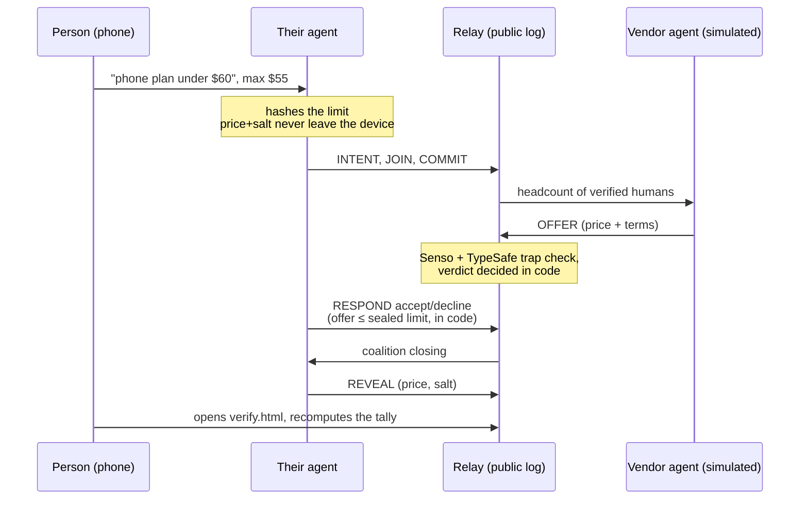

# Open Union

Strangers' personal agents pool their demand, bargain with a vendor as one buyer, and leave behind a public log anyone can re-check — without any member revealing the price they were willing to pay.

Built at the Personal Agents Hackathon, Nov 20, 2026. The protocol spec is [docs/CONTRACT.md](docs/CONTRACT.md).

## The problem

One agent shopping for one person has no leverage: the vendor quotes list price and means it. A thousand buyers would get a different number, but agents from different vendors have no shared way to find each other, prove how many of them are real people, or keep each person's walk-away price private while they bargain.

## Who is talking to whom

Agents talk to agents. A person does exactly two things: set a limit, and check the result afterwards. Nobody messages anybody directly — every line below is a row appended to one public log.



An LLM writes the sentences that appear on screen and decides nothing. The price curve, the headcount, the accept decision, the trap verdict and the final tally are all computed in code.

## What a person actually experiences

About thirty seconds on a phone at [`web/join.html`](web/join.html): type one sentence about what you want and the most you will pay, tap through a Persona identity check, and you are in. Your price and a 32-byte salt go into your browser's localStorage; the relay only ever receives `sha256("<price_cents>:<salt_hex>")`. From then on your agent negotiates. At the end you open [`web/verify.html`](web/verify.html), which re-checks the whole deal in your browser.

Any MCP client can be a member instead of the phone page — see [Let any agent join](#let-any-agent-join-mcp).

## Why you can trust it

- **Sealed limits.** Each member commits `sha256("<price_cents>:<salt_hex>")` before any offer exists. The relay rejects a second COMMIT, so a limit cannot be edited once offers arrive ([`app/relay.py`](app/relay.py)).
- **Only verified humans move the price.** The vendor's quote is `85 − 27.1 × ln(1 + n/200)` dollars with a $38 floor, where `n` counts only members whose Persona inquiry passed. The relay asks Persona itself and never trusts a status posted by a browser ([`app/persona.py`](app/persona.py), [`app/vendor.py`](app/vendor.py)).
- **The fine print is checked.** Senso retrieves the matching plan terms; TypeSafe returns a probability for three questions — does the price jump after an intro period, are there extra fees, is the contract longer than 12 months. Code applies the thresholds: pass only if every probability is under 0.30, ask the human between 0.30 and 0.70, otherwise reject ([`app/offer_check.py`](app/offer_check.py)). Every question, probability and citation is written to the log.
- **Independent verification.** [`web/verify.html`](web/verify.html) reads `/log` and nothing else, recomputes every hash with `crypto.subtle` in your browser, and reports how many commitments match and how many members accept. It does not trust the server's tally; [`app/tally.py`](app/tally.py) does the same arithmetic server-side so you can compare the two numbers. A reveal that does not hash to its commitment is counted as a mismatch, never silently dropped.

The protocol is six message types — `INTENT`, `JOIN`, `COMMIT`, `OFFER`, `RESPOND`, `REVEAL` — in one append-only log, with live updates over Server-Sent Events.

## Run it locally

Python 3.12.

```bash
python -m venv .venv && source .venv/bin/activate
pip install -r requirements.txt
python scripts/check_env.py          # prints key names and set/MISSING, never a value
uvicorn app.main:app --reload --port 8077
```

Keys go in a `.env` file in the repo root (gitignored, never committed). Names only: `SINGLESTORE_URL`, `ARCEE_API_KEY`, `ARCEE_MODEL_SMALL`, `ARCEE_MODEL_LARGE`, `TYPESAFE_API_KEY`, `SENSO_API_KEY`, `SENSO_BASE_URL` (optional), `PERSONA_API_KEY`, `PERSONA_TEMPLATE_ID`, `ANTHROPIC_API_KEY`.

Then open:

- `http://localhost:8077/stage.html` — the projector screen (`?presenter=1` adds the presenter panel: keys 1–6 run the demo beats, W runs the walkout, R resets the simulated parts and keeps real members)
- `http://localhost:8077/join.html` — the phone page for real members
- `http://localhost:8077/verify.html` — the in-browser verifier
- `http://localhost:8077/vendor.html?c=<coalition-id>` — vendor console for trying trap offers

Tests: `pytest`.

## Let any agent join (MCP)

[`union_mcp/`](union_mcp/server.py) is a local stdio MCP server that lets Claude Desktop, Cursor or any MCP client act as a member. Its tools are `union_find`, `union_join`, `union_status`, `union_verify`, `union_respond` and `union_reveal`. The walk-away price and salt stay in `~/.open-union/secrets.json`; no tool ever returns the price to the model, and the accept decision is a comparison in code.

```bash
RELAY_URL=http://localhost:8077 python -m union_mcp.server --print-config
```

```json
{
  "mcpServers": {
    "open-union": {
      "command": "/path/to/.venv/bin/python",
      "args": ["/path/to/open-union-hack/union_mcp/server.py"],
      "env": { "RELAY_URL": "http://localhost:8077" }
    }
  }
}
```

## Real, simulated, sandbox

- **Real:** the relay, the protocol and its public log (stored in SingleStore), the sha256 commitments and reveals, the in-browser verifier, the TypeSafe judgments, the Senso retrieval, and real members who join from the phone page or an MCP client.
- **Simulated:** the vendor — "Northline Mobile" is a fictional carrier — the ~300 seeded members ([`scripts/seed_members.py`](scripts/seed_members.py)), and the 500-account sign-up attack ([`scripts/sybil_attack.py`](scripts/sybil_attack.py)). Nothing is ever bought. Every simulated thing is labeled in the UI and in the log.
- **Sandbox:** Persona runs against its sandbox, which performs no real identity check, and the log and chat say so. With no Persona key the relay falls back to a clearly labeled stub.

## What each sponsor tool does here

| Tool | What it does in this product |
|---|---|
| **SingleStore** | Stores the log, coalitions and members, and shortlists similar coalitions by vector search ([`app/store.py`](app/store.py)) |
| **TypeSafe** | Returns a probability for a yes/no question — same service? price jump? ([`app/matching.py`](app/matching.py), [`app/offer_check.py`](app/offer_check.py)) |
| **Senso** | Retrieves the plan terms an offer must be checked against, cited by id in the log ([`app/offer_check.py`](app/offer_check.py)) |
| **Persona** | Confirms a member is a unique human before they count toward the headcount ([`app/persona.py`](app/persona.py)) |
| **Arcee** | Writes the one-line things the vendor and coalition say on screen; never sets a number ([`app/vendor.py`](app/vendor.py)) |
| **Firedrill** | Replays the sign-up attack and the trap offers against the relay's HTTP API ([`firedrill/`](firedrill/README.md)) |
| **Cognee** | Vendor memory of a past walkout, used to open $2 lower next time; off unless `COGNEE_MEMORY=1` ([`app/memory.py`](app/memory.py)) |

## The demo, in six beats

1. One agent asks alone; the vendor refuses.
2. The room joins — ~300 simulated members plus real people from their phones — and the quote falls along the curve.
3. A script signs up 500 fake accounts and the quote drops further.
4. Persona removes everyone unverified and the price is re-quoted from verified humans only.
5. The vendor's trap offer is rejected on the Senso + TypeSafe check; the clean offer passes.
6. The coalition closes, members reveal, and the verifier shows every commitment matching.

A seventh beat is the walkout: the coalition leaves, every member's phone shows a strike screen, and the vendor's published rules give a walkout $2 off the curve.

## Repository map

| Path | What it is |
|---|---|
| `docs/CONTRACT.md` | The protocol and the rules enforced in code |
| `app/` | The relay: `relay.py`, `matching.py`, `offer_check.py`, `persona.py`, `negotiation.py`, `vendor.py`, `tally.py`, `store.py` |
| `web/` | `stage.html`, `join.html`, `verify.html`, `vendor.html` — plain HTML and JS, no build step |
| `union_mcp/` | The MCP member adapter |
| `scripts/` | Seeded members, the sign-up attack, the env check |
| `firedrill/` | Firedrill simulation recipes |
| `docs/API_NOTES.md` | Request formats that worked against TypeSafe, Senso and Persona |
